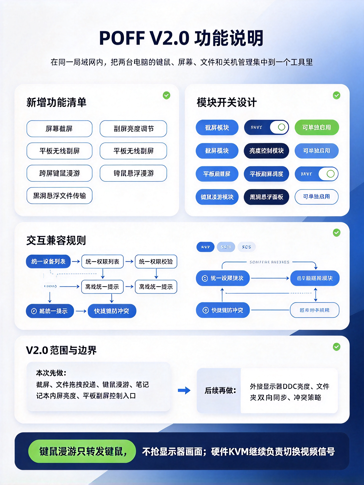
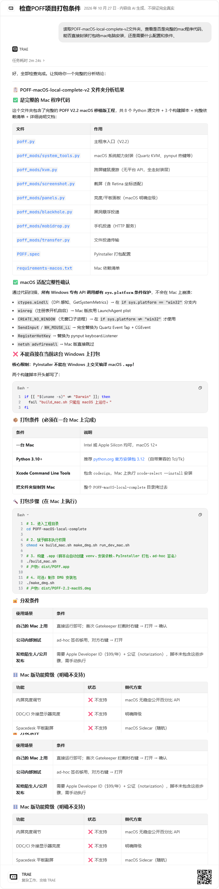

# POFF · 局域网多主机控制工具

> 把同一个局域网里的多台电脑当成「一组」来管理：并行同步关机、文件投递、截屏共享、手机扫码互传、跨屏键鼠漫游。
> Windows 与 macOS 双平台运行，单个可执行文件，无需安装服务端。


---

## 功能特性

| 模块 | 说明 | Windows | macOS |
|---|---|:---:|:---:|
| **并行同步关机** | 先扫描各主机正在运行的高风险应用（Office / 浏览器 / 编辑器等），汇总确认后进入 10 秒倒计时，再并行下发关机指令 | ✅ | ✅ |
| **单独关机** | 对单台主机执行同一套「预检 → 确认 → 关机」流程 | ✅ | ✅ |
| **连通校验** | 应答式 `HELLO/HELLO_ACK` 校验，并发探测所有主机，避免单向连通的误判 | ✅ | ✅ |
| **文件投递** | 通过 TCP + SHA-256 校验把文件投递到远端接收目录 | ✅ | ✅ |
| **黑洞悬浮面板** | 常驻悬浮窗，把文件直接拖到主机条目上即完成投递 | ✅ | ✅ |
| **屏幕截屏** | 全屏 / 框选截屏，预览、本地保存、一键发送给选中主机 | ✅ | ✅ |
| **手机投递 MobiDrop** | 手机不装 App，浏览器扫码即用；电脑 → 手机、手机 → 电脑双向投递，6 位配对码鉴权 | ✅ | ✅ |
| **跨屏键鼠漫游** | 双端双向 KVM：光标推到屏幕边缘即接管对端键鼠，持久 TCP 会话，支持紧急退回 | ✅ | ✅ |
| **亮度控制** | 本机内屏（WMI）+ 外接显示器（DDC/CI） | ✅ | ⚠️ 降级 |
| **平板副屏** | Spacedesk 服务调度 | ✅ | ⚠️ 改用 Sidecar |
| **托盘常驻 / 开机自启** | 关闭窗口不退出，登录后自动在托盘常驻 | ✅ | ✅ |
| **配置持久化** | 主机列表、模块开关、目录设置自动保存，重启即恢复 | ✅ | ✅ |

### 跨屏键鼠漫游架构



---

## 快速开始

### Windows

方式一：下载发布版（推荐）

1. 到 [Releases](../../releases) 下载 `Poff.exe`
2. 双击运行；如需开机自启与自动放行防火墙，右键「以管理员身份运行」
3. 首次启动会提示防火墙放行 `17890` / `17891` 端口，请选择「允许」

方式二：从源码运行

```powershell
python -m venv .venv
.\.venv\Scripts\Activate.ps1
python -m pip install -r requirements.txt
python poff.py
```

### macOS

macOS 版**必须在一台 Mac 上构建**（PyInstaller 无法交叉编译）：

```bash
cd macos
chmod +x build_mac.sh make_dmg.sh run_dev_mac.sh
./build_mac.sh        # 产物：dist/POFF.app
./make_dmg.sh         # 可选：产物：dist/POFF-2.2-macOS.dmg
```

前置条件：macOS 12+、[python.org](https://www.python.org/downloads/macos/) 的 Python 3.12（自带兼容 Tk）、`xcode-select --install` 安装的 Command Line Tools。

详细说明见 [macos/README_MAC.md](macos/README_MAC.md) 与 [macos/PORTING_NOTES.md](macos/PORTING_NOTES.md)。



---

## 使用流程

1. **配对**：在其中一台点「生成本机串码」，把串码（或直接 `IP:端口`）发给另一台，在「添加主机」里粘贴
2. **校验**：点「全部校验」，确认对方在线（`● 在线`）
3. **关机**：选中主机点「单独关机（预检）」，或点「启动 10 秒并行同步关机」
4. 预检窗口会列出对端正在运行的高风险应用；确认后开始 10 秒倒计时，倒计时期间可随时取消
5. **投递**：把文件拖到黑洞面板的主机条目上，或进入「黑洞投递」标签页选择文件
6. **手机互传**：在「黑洞投递」页用手机扫描二维码，输入屏幕上显示的 6 位配对码即可

> 串码本质是 `poff|版本|IP|端口` 的 Base32 编码，方便复制粘贴，不含任何密钥。

---

## 网络端口与协议

| 端口 | 协议 | 用途 |
|---|---|---|
| `17890` | TCP / UDP | 主机控制协议、文件投递、KVM 键鼠会话 |
| `17891` | TCP (HTTP) | MobiDrop 手机投递页 |

控制协议为行分隔文本，首行为指令名，向后兼容：

```text
HELLO / HELLO_ACK          连通校验
PRECHECK                   远端进程预检（返回 JSON）
START / CANCEL             倒计时开始 / 取消
SINGLE_SHUTDOWN            单机立即关机
SHUTDOWN                   并行同步关机
KVM_HELLO / KVM_OK         KVM 会话握手（回传对端屏幕尺寸）
KVM_M / KVM_K              KVM 鼠标 / 键盘事件（JSON）
KVM_BYE                    KVM 会话结束
```

KVM 跨平台兼容：网络层统一使用 Windows Set-1 扫描码，macOS 端在收发两侧完成 Quartz keycode ↔ Set-1 的映射，因此 Windows ↔ macOS 可以互控。

---

## 全局热键

| 热键 | 功能 |
|---|---|
| `Ctrl + Shift + F` | 全屏截屏 |
| `Ctrl + Shift + S` | 选区截屏 |
| `Ctrl + Shift + H` | 显示 / 隐藏黑洞面板 |
| `Ctrl + Shift + L` | 漫游中紧急退回本机（漫游模块开启后生效） |

热键随对应模块开关自动注册 / 注销；被其他程序占用时会在日志中提示。

---

## 权限要求

**Windows**

- 普通权限即可使用全部核心功能
- 管理员权限额外带来：自动写入 `17890` / `17891` 防火墙放行规则（避免首次弹窗被误点成「阻止」导致对端永远显示未在线）
- KVM 键鼠钩子建议在管理员权限下运行

**macOS**

| 权限 | 用途 |
|---|---|
| 辅助功能 | KVM 键鼠注入 |
| 输入监控 | KVM 全局键鼠监听 |
| 屏幕与系统录音 | 截屏 |
| 自动化 / System Events | 本机关机（仅在主动执行时弹出） |
| 传入网络连接 | 首次监听 17890 / 17891 |

权限变更后 macOS 通常要求退出并重新打开 POFF。

---

## ⚠️ 安全说明

请务必阅读后再使用：

- **本工具设计用于完全可信的局域网**（家庭、办公室内网）。主机控制协议 `17890` **不包含身份认证与传输加密**，任何能访问该端口的设备都可以发起关机、投递文件、建立 KVM 会话。
- `17891` 手机投递页除健康检查外均要求 6 位配对码，但同样**不是加密通道**。
- 请勿把 `17890` / `17891` 暴露到公网，也不要在公共 Wi-Fi、访客网络或开启 AP 隔离之外的不可信环境中使用。
- 关机是破坏性操作：虽然会先做进程预检并给出 10 秒可取消倒计时，但**倒计时结束后无法撤回**，请确认目标主机没有正在进行的重要工作。
- KVM 漫游会在开启期间接管本机键鼠输入，请在确认触发边缘与 `Ctrl + Shift + L` 退回方式后再启用。

---

## 平台功能差异

| 能力 | Windows | macOS | 说明 |
|---|---|---|---|
| 内屏亮度 | WMI | 不支持 | macOS 无稳定公开的百分比亮度 API，UI 明示不支持而非伪造 |
| 外接显示器亮度 | DDC/CI | 不支持 | 同上 |
| 平板副屏 | Spacedesk | Sidecar | Spacedesk 驱动仅 Windows |
| 开机自启 | 注册表 Run | LaunchAgent | 各自平台原生方案 |
| 全局热键 | RegisterHotKey | pynput | |
| 键鼠钩子 / 注入 | WH_*_LL + SendInput | Quartz Event Tap + CGEvent | |
| 防火墙 | netsh 规则 | 系统应用防火墙 | macOS 首次连接由系统弹窗授权 |

---

## 项目结构

```text
.
├── poff.py                  # Windows 主程序（V2.2）
├── poff_mods/               # Windows 功能模块
│   ├── kvm.py               #   跨屏键鼠漫游：状态机 + KVM 会话
│   ├── system_tools.py      #   系统能力：热键、钩子、注入、亮度、Spacedesk
│   ├── screenshot.py        #   全屏 / 选区截屏
│   ├── blackhole.py         #   黑洞悬浮投递面板
│   ├── mobidrop.py          #   手机投递 HTTP 服务 + 二维码
│   ├── panels.py            #   亮度 / 平板副屏面板
│   └── transfer.py          #   文件投递传输层
├── macos/                   # macOS 移植版（同结构，system_tools 换 Quartz 实现）
│   ├── poff.py
│   ├── poff_mods/
│   ├── POFF.spec            # pyinstaller 打包配置
│   ├── build_mac.sh         # 构建 POFF.app
│   ├── make_dmg.sh          # 打包 DMG
│   └── README_MAC.md
├── docs/
│   ├── POFF V1.0 局域网多主机同步关机工具 · 需求文档与代码样板.docx
│   ├── POFF V2.0 功能说明文档与代码样板.docx
│   ├── POFF V2.0 新增功能需求整理与可行性方案.docx
│   └── images/
├── POFF.spec                # Windows 单文件 exe 打包配置
├── build_windows.ps1        # Windows 一键构建脚本
├── requirements.txt         # Windows 依赖
└── poff.ico
```

---

## 从源码构建

**Windows**

```powershell
python -m pip install -r requirements.txt
.\build_windows.ps1
# 产物：dist\Poff.exe（单文件，无需安装）
```

**macOS**

```bash
cd macos && ./build_mac.sh && ./make_dmg.sh
```

macOS 分发说明：构建脚本默认使用 ad-hoc 签名，适合本机与内部测试（首次打开需右键 →「打开」）。若要对外分发且不触发 Gatekeeper 警告，需要 Apple Developer ID 证书并完成公证：

```bash
codesign --options runtime --timestamp --sign "Developer ID Application: <你的证书>" POFF.app
xcrun notarytool submit POFF-2.2-macOS.dmg --wait
xcrun stapler staple POFF-2.2-macOS.dmg
```

---

## 版本历史

| 版本 | 主要变化 |
|---|---|
| **V2.2** | 手机投递 MobiDrop（扫码即用、6 位配对码、双向传输）；手机设备条目，关机自动跳过；黑洞投递拖放修复；KVM 鼠标帧合并降低 WiFi 抖动漂移 |
| **V2.1** | 跨屏键鼠漫游开放真实转发（持久 TCP 会话 + 双端双向）；外接显示器 DDC/CI 亮度滑块；`Ctrl+Shift+L` 紧急退回 |
| **V2.0** | 四区布局界面重构；截屏模块；黑洞悬浮投递；亮度控制；平板副屏；漫游布局编辑器 |
| **V1.0** | 局域网多主机同步关机、连通校验、关机前预检、托盘与开机自启 |

---

## 已知限制

- 跨屏键鼠漫游对无线网络较敏感：已实现事件帧合并与失败自动退回，但高丢包环境下仍可能出现光标漂移；有线网络体验最佳。
- macOS 版亮度调节、Spacedesk 明确不支持（见上文功能差异）。
- macOS 版 KVM 键位映射覆盖常用 ANSI 键盘，特殊媒体键 / 非标准布局可能缺失映射。
- 手机设备仅支持文件投递，不参与关机指令。
- 端口为固定值（`17890` / `17891`），同一台机器上不能并行运行两个实例。

---

## 免责声明

本工具会执行**远程关机**这一破坏性操作，并可能接管键鼠输入。请仅在你有权管理的设备与网络中部署，并在使用前确认目标主机上的工作已保存。因误用、误连或网络配置不当造成的损失由使用者自行承担。

---

## License

[MIT](LICENSE)
